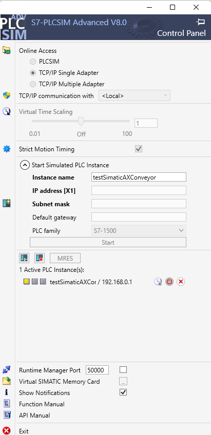
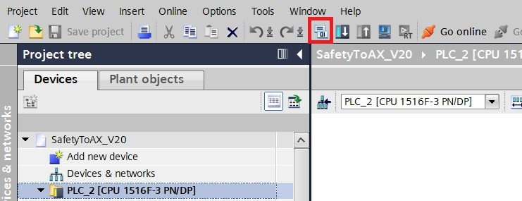
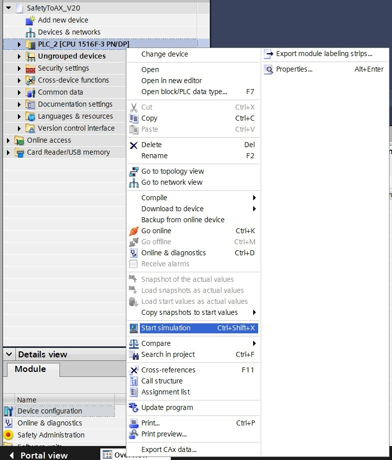
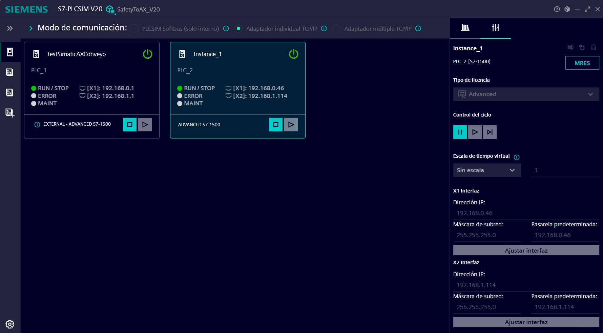
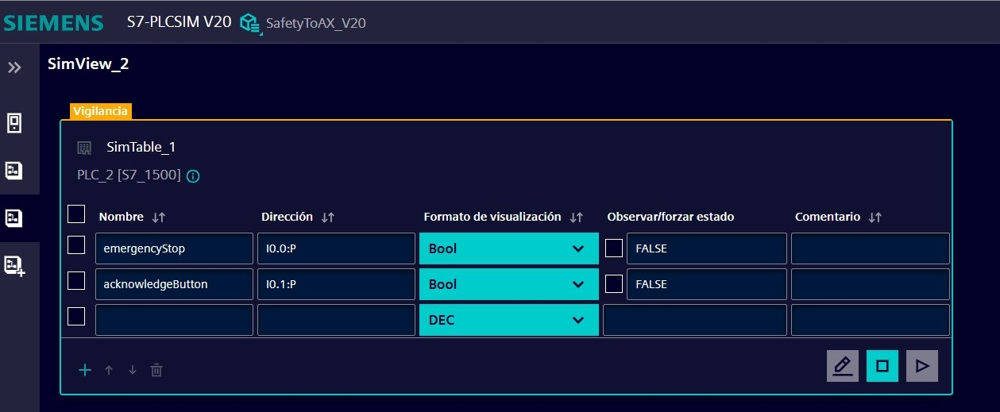
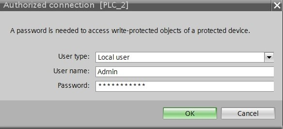
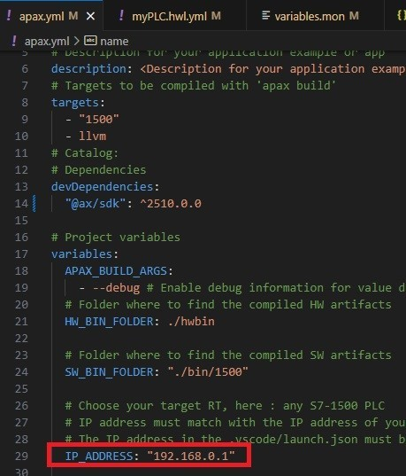
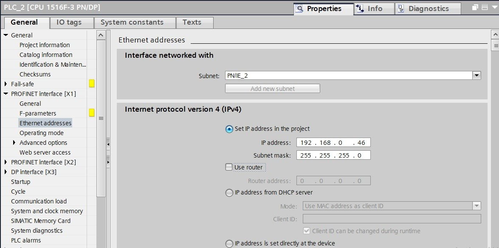

# Safety with TIA FPLC
## Description

This is an application example for SIMATIC AX that demonstrates communication between a standard PLC (SIMATIC AX application) and a Safety PLC (programmed in TIA Portal) using TCP/IP. The standard PLC implements the conveyor state machine (STOPPED → STARTING → RUNNING → FAULT) and item counting. The Safety PLC is responsible for all safety-related inputs  and provides a single aggregated SafetyOK signal to the AX application. The Safety PLC always remains the authority for safety decisions. AX only requests motor action and reports state.

The simulation uses two PLCs: the AX PLC runs in a PLCSIM Advanced instance, and the safety F-PLC from the TIA Portal project runs in a separate PLCSIM instance. They communicate with each other over TCP/IP. By default, the AX PLC uses `192.168.0.1` and the TIA safety PLC uses `192.168.0.46`. TIA sends the `SafetyOK` signal to the AX PLC at TCP port `2001`.
## Used components

- Simatic AX
- PLCSIM Advanced V7.0 (PLC FW V4.0)
- PLC-SIM
- TIA Portal V20 (Safety PLC project)


## Project Installation

1. Open a command line interface (CLI) and switch to the target folder. E.G, if the target folder is C:/Users/user/Desktop

   ```sh
   C:
   cd \Users\user\Desktop
   ```

2. Install the application example on your local PC.

   Run the following command in the CLI:

   ```sh
   apax create @simatic-ax/ae-safety-with-tia-fplc --registry https://npm.pkg.github.com ae-safety-with-tia-fplc 
   ```

   Open **AxCode** with

   ```sh
   cd ae-safety-with-tia-fplc
   axcode .
   ```

3. If it does not open automatically, open a terminal: (`CTRL+ ´`)

4. Start a PLCSIM Advanced instance for the AX PLC. The project uses PLC firmware V4.0, so use PLCSIM Advanced 7.0 or later. Set its IP address to `192.168.0.1`, matching `IP_ADDRESS` in `apax.yml`, the IP in `.vscode/launch.json`, and interface X1 in `hwc/myPLC.hwl.yml`. To change the IP, [follow the instructions](#prepare-configuration).

   

:warning:
You must have the AX PLCSIM Advanced instance running. Online access must be set to TCP/IP Single Adapter using the IP address and mask configured in the project.

## How to run this project

The process will be splitted in two different phases, one for setting up the Simatic AX PLC and then after that one is running, set up the FPLC by using TIA Portal and PLC Sim.

### Simatic AX PLC

We provide the solution ready to compile and download the **Conveyor Logic** hardware and software after completing the security setup described below. The *create_certificate* script uses **OpenSSL** to generate an X.509 certificate and a PKCS#12 container containing the certificate and private key. The generated files are stored in the *certificate* folder.

This project includes IO modules in the hardware configuration and their mapping to global variables. In this simulation scenario, the variables use different addresses to avoid being overwritten by cyclic IO updates.

The process to run the project with the hardware configuration follows this steps:

1. Run _apax install_ to install all the project dependencies.

2. Run the script _create_certificate_ that will generate the certificate in .crt format and the public and private key in PKCS#12 format.

3. Run the script _hwc_setup_secure_communication_ to create the PLC security configuration.

4. Run the script _hwc_import_certificate_ to import the TLS certificate into the security configuration.

5. Run the script _hwc_add_user_ to set the password for "User1". The user's roles and permissions are configured under `UserManagement` in `hwc/myPLC.hwl.yml`.

6. Run the script _hcl_. Here the hardware configuration is compiled and downloaded to the plc instance.

7. Run the script _scl_. The application is built and transferred to the instance.

For instructions on operating the conveyor and simulating its inputs, see [Operating the simulation](docs/process.md).

### TIA Portal Configuration

We provide you a ready to use project for the FPLC with the Safety Logic of this system. The project is located  under the `external/` folder as a compressed file `SafetyToAX_V20.zap20`. It contains a safety FPLC with a safety input card, the project has implemented an Emergency Button and its acknowledgement.

Run the safety F-PLC from this TIA Portal project in a separate PLCSIM instance. Its default IP address is `192.168.0.46`. It communicates with the AX PLC at `192.168.0.1` over TCP/IP.

For being able to run the project, follow this steps:

1. Compile the solution by clickin on the  compile button:

   

2. Start the simulation of the FPLC, right click on the PLC and then:

   

3. Create a PLCSIM instance for the safety F-PLC with the configured IP address `192.168.0.46` and the required network adapter:

   

4. Create a Simulation Table and add the two configurated safety digital inputs to manipulate:

   

:warning:
Once the project has been loaded to the device once, it is protected so you will need to add credentials to access to the PLC. The credentials can be found under Users and Roles on the device. The user should be "Admin" and the password has been added into the comments: "Siemens123!"
   

### Prepare configuration

Modify the IP addresses for your use case, whether if it is running in the same computer or different stations.

Default simulation IP addresses:

- AX PLC (PLCSIM Advanced): `192.168.0.1`
- TIA safety F-PLC (PLCSIM): `192.168.0.46`

Keep the two addresses different and in the same subnet so the PLCs can communicate over TCP/IP.

Where to modify the IP address in **SIMATIC AX**:

- Modify `IP_ADDRESS` in `apax.yml`, the IP in `.vscode/launch.json`, and interface X1's IP address and mask in `hwc/myPLC.hwl.yml`:

    

Where to modify the IP address in **TIA Portal**:

- Modify the IP address and mask under Device Configuration > Properties > PROFINET Interface [X1] > Ethernet addresses. This is the safety F-PLC address, `192.168.0.46` by default:

   

## Contribution

Thanks for your interest in contributing. Everybody is free to report bugs, unclear documentation, and other problems regarding this repository in the issues section, or even better, is free to propose any changes to this repository using Merge Requests.

### Markdownlint-cli

This workspace will be checked by the [markdownlint-cli](https://github.com/igorshubovych/markdownlint-cli) (there is also documented ho to install the tool) tool in the CI workflow automatically.  
To avoid, that the CI workflow fails because of the markdown linter, you can check all markdown files locally by running the markdownlint with:

```sh
markdownlint **/*.md --fix
```

## License and Legal information

Please read the [Legal information](LICENSE.md)