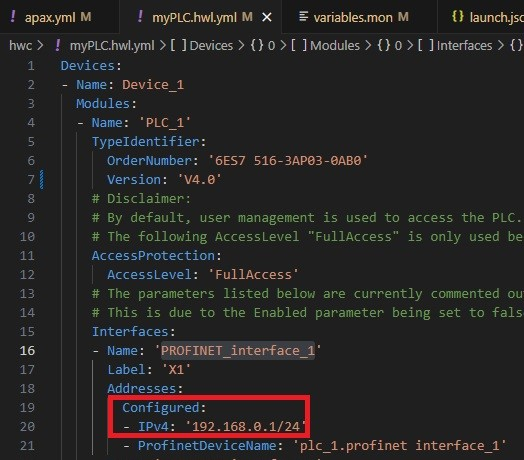
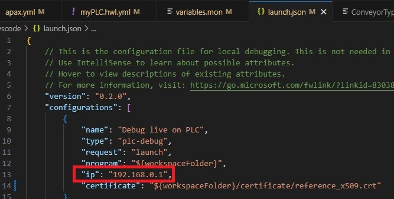

# Safety with TIA FPLC
## Description

This is an application example for SIMATIC AX that demonstrates communication between a standard PLC (SIMATIC AX application) and a Safety PLC (programmed in TIA Portal) using TCP/IP. The standard PLC implements the conveyor state machine (STOPPED → STARTING → RUNNING → FAULT) and item counting. The Safety PLC is responsible for all safety-related inputs  and provides a single aggregated SafetyOK signal to the AX application. The Safety PLC always remains the authority for safety decisions; AX only requests motor action and reports state.
## Used components

- Simatic AX
- PLCSIM Advanced V7.0 (PLC FW V4.0)
- PLC-SIM
- TIA Portal V20 (Safety PLC project)


## Project Installation

1. Open a command line interface (CLI) and switch to the target folder. E.G, if the target folder is C:/Users/user/Desktop

   ```sh
   C:
   cd \Users\user\Desktop
   ```

2. Install the application example on your local PC.

   Run the following command in the CLI:

   ```sh
   apax create @simatic-ax/ae-safety-wtih-tia-fplc --registry https://npm.pkg.github.com ae-safety-with-tia-fplc 
   ```

   Open **AxCode** with

   ```sh
   cd ae-safety-wtih-tia-fplc
   axcode .
   ```

3. If it does not open automatically, open a terminal: (`CTRL+ ´`)

4. Start a PLCSIM Advanced Instance (we are using a FW V4.0 PLC, so please use at least PLCSIm Advanced 7.0) with the same IP address that you will use in the `apax.yml`, the `.vscode/launch.json` and the `myPLC.hwl.yml` of the project. To change the IP, [follow the instructions](#prepare-configuration).

:warning:
You must have a PLCSIM Advanced instance running. Online access must be set to TCP/IP Single Adapter using the IP address and mask configured in the project

## How to run this project

The process will be splitted in two different phases, one for setting up the Simatic AX PLC and then after that one is running, set up the FPLC by using TIA Portal and PLC Sim.

### Simatic AX PLC

We provide you the solution already prepared for being able to run the **Conveyor Logic** with just compilling and downloading the hardware and software. The hardware certificates and user configuration were already created from our side. The hardware certificate will bee generated using a third-party tool, in this case **OpenSSL**. The _create_certificate_ script will generate an X.509 certificate containing the private keys saved as PKCS#12 certificate. These files are located under the _certificate_ folder. This process is out of the scope of this project.

This project shows as well how to add IO modules to the hardware configuration and how to do the mapping in the global variables. In this simulation scenario, the variables have been moved to different addresses to avoid the overwriting of the inputs and outputs on every PLC cycle.

The process to run the project with the hardware configuration follows this steps:

1. Run _apax install_ to install all the project dependencies.

2. Run the script _create_certificate_ that will generate the certificate in .crt format and the public and private key in PKCS#12 format.

3. Run the script _ hwc_setup_secure_communication_  that will setup the secure communication and then will import the certificate to the hardware.

4. Run the script _hwc_import_certificate_ that will add the certificate to the project json that will be loaded into the PLC 
4. Run the script _set-password_ to enable the password for the user configurated "User1".

5. Run the script _hcl_. Here the hardware configuration is compiled and downloaded to the plc instance.

6. Run the script _scl_. The application is built and transferred to the instance.

In addition, there are commands to control the conveyor from AX side:

- Start: Simulate input for start button
- Stop: Simulate input for stop button
- Pulse_itemA: Simulate input for item in the position A to increment the counter
- Pulse_itemB: Simulate input for item in the position B to decrement the counter

### TIA Portal Configuration

We provide you a ready to use project for the FPLC with the Safety Logic of this system. The project is located  under the `external/` folder as a compressed file `SafetyToAX_V20.zap20`. It contains a safety FPLC with a safety input card, the project has implemented an Emergency Button and its acknowledgement.

For being able to run the project, follow this steps:

1. Compile the solution by clickin on the  compile button:

   

2. Start the simulation of the FPLC, right click on the PLC and then:

   

3. Create the PLC Sim Instance of the device with the right IP address, license, and adapter:

   

4. Create a Simulation Table and add the two configurated safety digital inputs to manipulate:

   

:warning:
Once the project has been loaded to the device once, it is protected so you will need to add credentials to access to the PLC. The credentials can be found under Users and Roles on the device. The user should be "Admin" and the password has been added into the comments: "Siemens123!"
   

### Prepare configuration

Modify the IP addresses for your use case, whether if it is running in the same computer or different stations.

Where to modify the IP Addresses in **SIMATIC AX**:

- Modify the IP Address and mask at line 20 in `hwconfiguration\myPLC.hwl.yml`:

    

- Modify the IP Address at line 29 in `apax.yml`:

    

- Modify the IP Address at line 13 in `.vscode\launch.json`

    

Where to modify the IP Addresses in **TIA Portal**:

- Modify the IP Address and mask under Device Configuration > Properties > PROFINET Interface [X1] > Ethernet addresses:

   

## Contribution

Thanks for your interest in contributing. Everybody is free to report bugs, unclear documentation, and other problems regarding this repository in the issues section, or even better, is free to propose any changes to this repository using Merge Requests.

### Markdownlint-cli

This workspace will be checked by the [markdownlint-cli](https://github.com/igorshubovych/markdownlint-cli) (there is also documented ho to install the tool) tool in the CI workflow automatically.  
To avoid, that the CI workflow fails because of the markdown linter, you can check all markdown files locally by running the markdownlint with:

```sh
markdownlint **/*.md --fix
```

## License and Legal information

Please read the [Legal information](LICENSE.md)