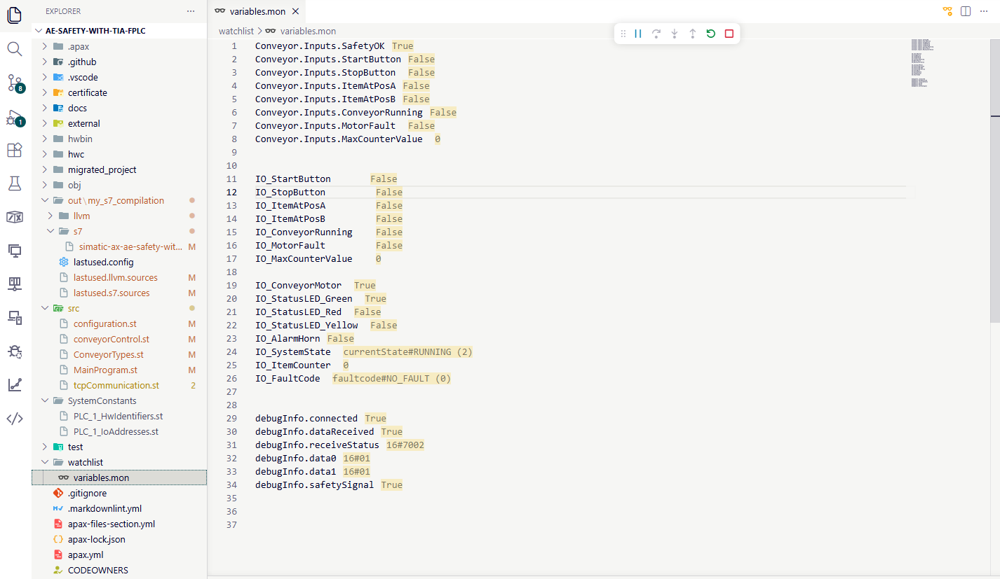

## Operating the simulation

Run these commands from the AX project terminal. Keep both PLC simulations in **RUN** and make sure the safety F-PLC is sending `SafetyOK = TRUE` and `IO_MotorFault = FALSE` before starting. AX initializes `SafetyOK` to `FALSE`, so it records a general safety fault and turns on `AlarmHorn` until it receives `SafetyOK = TRUE` and a start completes successfully.

- `apax start`: pulses the start input. The conveyor starts only when the system is enabled and **STOPPED**, then waits two seconds before entering **RUNNING**.
- `apax stop`: pulses the stop input and stops the conveyor.
- `apax pulse_itemA`: pulses the position A sensor. While **RUNNING**, its rising edge increments the counter up to `MaxCounterValue`.
- `apax pulse_itemB`: pulses the position B sensor. While **RUNNING**, its rising edge decrements the counter down to zero.

Use `apax monitor` to observe the PLC inputs and outputs in the terminal while testing or use the .mon file to monitor the variables in real time.

## 1. System States (State Machine)

### State 0: STOPPED

- Conveyor motor OFF
- Red LED ON
- Waiting for Start while the system is enabled (`SafetyOK` is `TRUE` and `MotorFault` is `FALSE`)
- Can be entered by pushing `Stop` or when safety is restored

### State 1: STARTING

- Yellow LED ON
- 2-second startup delay
- After delay → **RUNNING**

### State 2: RUNNING

- Conveyor motor ON
- Green LED ON
- Item counting active (position A increments and position B decrements)
- Normal operation

### State 3: FAULT

- `CheckSafety` sets the internal state to `FAULT` and disables the motor when `SafetyOK` is `FALSE` or `MotorFault` is `TRUE`.
- `AlarmHorn` is ON while `FaultCode` is latched.
- When the system is disabled, `ProcessButtons` sets the state to `STOPPED` in the same scan. Therefore, `IO_SystemState` reports `STOPPED` while `FaultCode` remains latched.
- After restoring safety and clearing any motor fault, press `Start`. `FaultCode` clears only after the two-second start sequence completes and the state enters `RUNNING`.

## 2. Safety Logic
- `SafetyOK`: Single input from your safety relay line (handles E-Stop, gates, curtains internally).
- `MotorFault`: Additional motor protection input.
- If `SafetyOK` becomes `FALSE` or `MotorFault` becomes `TRUE`, the system is disabled and `IO_ConveyorMotor` is turned off.
- When `SafetyOK` is restored, the system returns to **STOPPED**. Press `Start` to begin a new start sequence.
- `FaultCode` is latched when a fault is detected and remains set after the system returns to **STOPPED**. It is cleared to `NO_FAULT` only when a start completes successfully and the state enters **RUNNING**.
- Fault codes: _0_ = no fault, _1_ = general safety fault, _2_ = motor fault, _3_ = extended safety loss.

## 3. Start/Stop Logic
- `Start`: Works only when **STOPPED** and `SystemEnabled` (`SafetyOK` is `TRUE` and there is no `MotorFault`) and a rising edge is detected.
- `Stop`: Works anytime. A rising edge sends the system to **STOPPED** immediately.
- Edge Detection: `Start` and `Stop` use rising-edge detection to prevent repeated triggers from held buttons.
- Safety-driven state changes: Safety loss disables the motor. Restore safety and press Start to restart.
## 4. Item Counting Logic
- Position A is at the conveyor entrance and detects an item entering. Position B is at the exit and detects an item leaving.
- Position A (`ItemAtPosA`) increments the counter on a rising edge. Position B (`ItemAtPosB`) decrements it on a rising edge.
- The counter changes only while **RUNNING** and is clamped between zero and `MaxCounterValue`.
- If both sensors have a rising edge in the same cycle, their changes cancel out.
## 5. Output Control

- Motor: `IO_ConveyorMotor` is ON only when `ConveyorCommand = TRUE` and `SystemEnabled = TRUE` (`SafetyOK` is `TRUE` and there is no `MotorFault`).
- LEDs: Visual indication per state
- Red: ON in **STOPPED** or **FAULT**, and on a detected safety loss.
- Yellow: ON in **STARTING**, and indicates ready-for-restart when safety is restored in **FAULT**.
- Green: ON in **RUNNING**.
- Alarm: `AlarmHorn` is ON while `FaultCode` is not `NO_FAULT`. It turns off when a successful start clears the fault code.
- HMI data: `SystemState`, `ItemCounter`, and `FaultCode` are exposed for monitoring.

## 6. Execution Flow (Every PLC Cycle)

1. `CheckSafety()` → Evaluate safety conditions and detect loss/restore
2. `ProcessButtons()` → Handle `Start`/`Stop` edges and transitions
3. `HandleStateMachine()` → Execute state transitions and start-delay handling
4. `ProcessItems()` → Detect position A/B sensor edges and update the counter when **RUNNING**
5. `SetOutputs()` → Update motor, LEDs, alarm, HMI data and fault codes